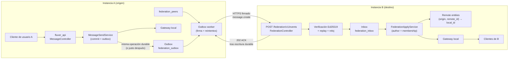
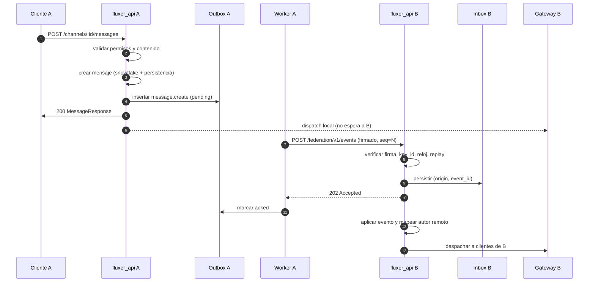
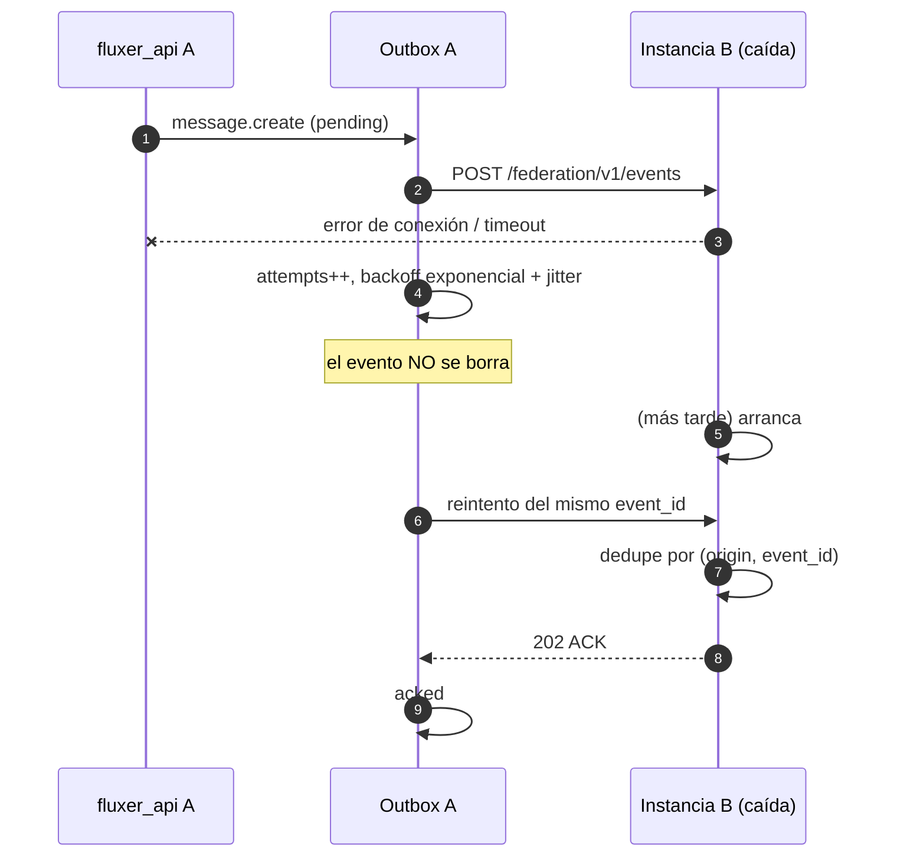
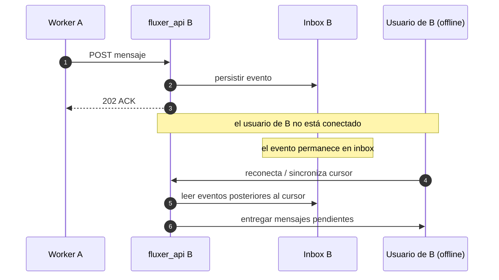
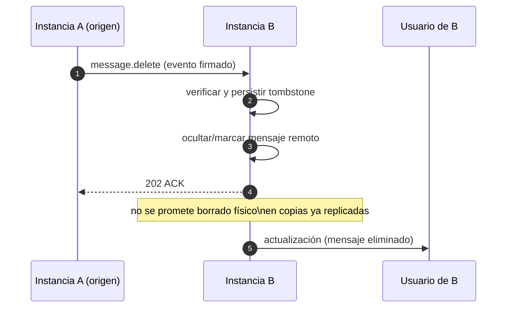
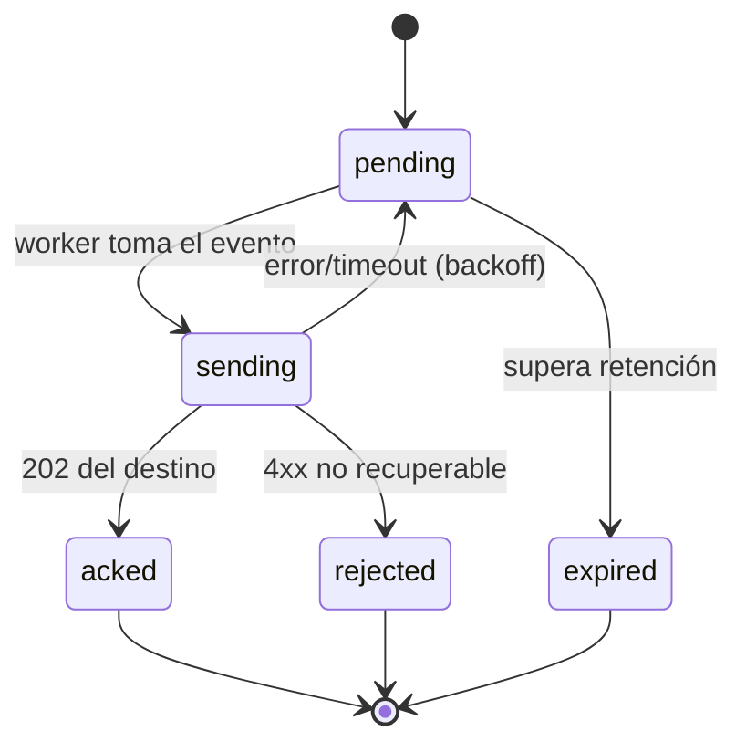
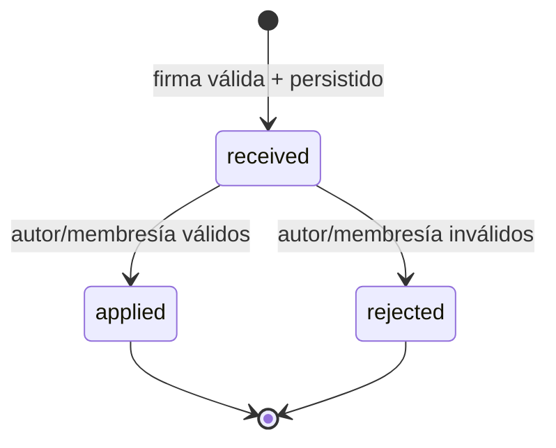
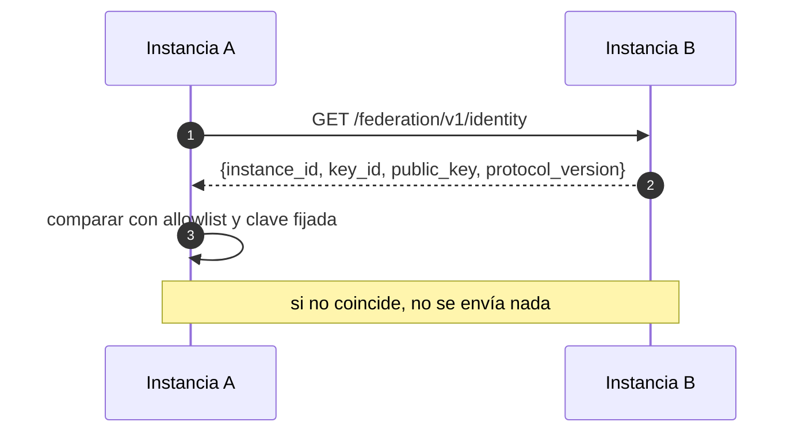

# Recorrido de un mensaje federado

Diagrama del MVP descrito en `federation-mvp.md`. Rama: `feat/federation-mvp`.

---

## 1. Componentes

---

## 2. Secuencia: entrega normal

El envío local no espera a B. La federación es asíncrona y reintentable.

---

## 3. Secuencia: destino apagado

La instancia origen conserva el evento hasta ACK o expiración explícita.

---

## 4. Secuencia: receptor con usuarios desconectados

El inbox no se vacía por no haber usuarios conectados. La retención es una
política explícita (30 días por defecto), no "hasta que se entregue a los activos".

---

## 5. Secuencia: borrado con tombstone

---

## 6. Estados

### Outbox

### Inbox

---

## 7. Handshake entre instancias

En el MVP el handshake es opcional: la allowlist y las claves fijadas bastan.
El endpoint de identidad sirve para rotación de claves y diagnóstico.
